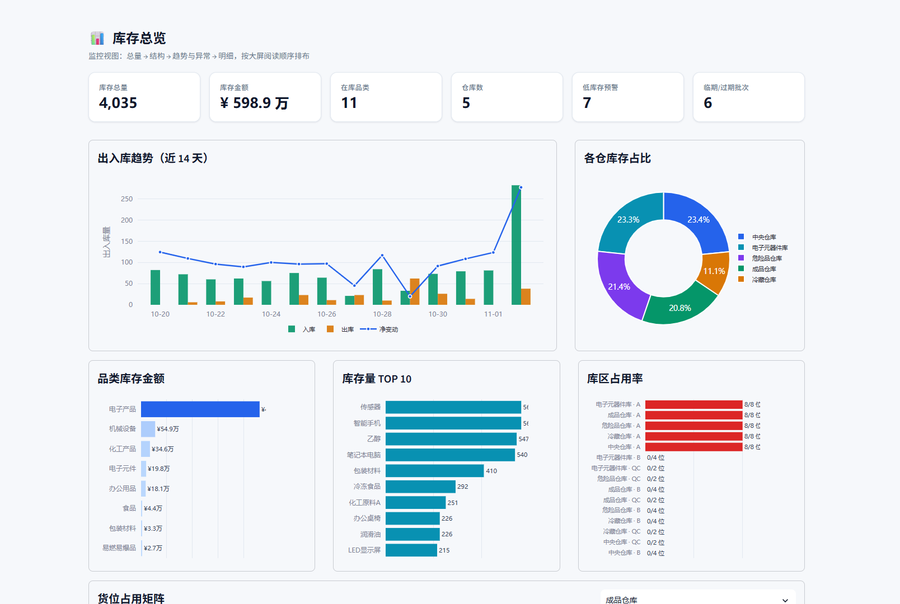
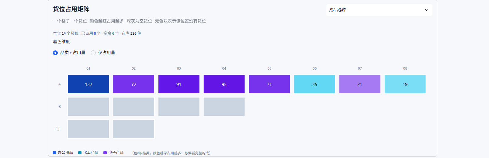

# 智能仓库管理系统 · Warehouse Management System

> 一个从课程设计演进到可运转 WMS 的完整案例：保留原始版本（V1），并提供经过数据库重构与作业层扩展的优化版本（V2）。
>
> SQL Server + Python / Streamlit ｜ 数据库设计 · 事务边界 · 分层架构 · 可视化监控

---

## 一、项目定位

仓库管理的核心不是"把数字记下来"，而是保证**每一次库存变动都有依据、可追溯、经得起盘点**。本项目围绕这一目标，实现了从主数据、库存台账、单据作业到审计追溯的完整闭环。

仓库同时保留两版实现，用途不同：

| 版本 | 目录 | 定位 | 适合谁看 |
|---|---|---|---|
| **V1 原始版** | [`v1-legacy/`](v1-legacy/) | 课程设计原始提交版，单文件、能跑通、功能齐全 | 想了解"起点是什么样"、做前后对比 |
| **V2 重构版** | [`v2-wms/`](v2-wms/) | 数据库与工程结构重构后的完整 WMS | 想直接运行、阅读设计、作为简历项目 |

> V1 仅用于对照与追溯，不建议用于真实业务；V2 是主要交付版本。

---

## 界面预览





> 截图取自演示数据，按 1920×1080 取景。

---

## 二、两版一览

| 维度 | V1 原始版 | V2 重构版 |
|---|---|---|
| 代码组织 | 单文件约 750 行，UI / SQL / 业务混写 | 5 层结构，Python 约 4,800 行 |
| 数据访问 | pyodbc 直连，6 处 f-string 拼 SQL | SQLAlchemy 连接池，全参数化 |
| 数据库对象 | 9 表 / 0 视图 / 0 存储过程 / 3 触发器 | **22 表 / 13 视图 / 7 存储过程 / 3 触发器 / 13 索引** |
| 业务能力 | 手工出入库、调拨、查询、审计 | 单据化入库 / 出库 / 调拨 / 盘点，批次效期、FEFO、库位管理 |
| 事务边界 | 应用层逐条执行，失败可能半途而废 | 核心作业封装为存储过程，单事务提交或整体回滚 |
| 并发保护 | 校验与扣减分离，存在超卖窗口 | `UPDLOCK + HOLDLOCK` 圈定"读-判-写"临界区 |
| 界面 | 5 个功能页，Streamlit 默认样式 | 8 个页面 + 监控大屏 + 统一设计系统 |
| 测试 | 无 | 40 项自动化测试（数据库 26 + 应用 14） |

详细差异与改造理由见 [`docs/04-版本差异与迁移说明.md`](docs/04-版本差异与迁移说明.md)。

---

## 三、目录结构

```
warehouse-management-system/
├── README.md                       本文件：仓库总览与快速开始
├── LICENSE                         MIT License
├── .gitignore                      排除虚拟环境、本地连接配置与缓存
│
├── docs/                           项目级文档（两版共用）
│   ├── 01-项目概述.md              背景、目标、范围、成果
│   ├── 02-数据库设计.md            表结构、范式、约束、视图、过程、触发器、索引
│   ├── 03-系统架构与实现.md        分层、调用链、事务、异常、界面设计
│   ├── 04-版本差异与迁移说明.md    V1 → V2 的问题清单与改造路径
│   ├── 05-运行与部署.md            环境准备、配置、启动、排错
│   ├── 06-测试与验证.md            测试清单、覆盖范围、执行方式
│   ├── 07-数据字典.md              22 张表的字段说明（自动生成）
│   └── assets/
│       └── er-v2.drawio            V2 完整 ER 图（draw.io 打开）
│
├── v1-legacy/                      原始版：单文件 + 原始建库脚本
│   ├── README.md
│   ├── app.py
│   ├── requirements.txt
│   ├── 启动.bat
│   ├── db.env.example
│   ├── docs/ER图.drawio
│   └── sql/
│       ├── 01_schema.sql           9 张表 + 3 个触发器
│       └── 02_seed.sql             演示数据（构造数据）
│
└── v2-wms/                         重构版：分层应用 + 作业层
    ├── README.md
    ├── app.py                      入口：导航与页面装配
    ├── requirements.txt
    ├── 启动.bat
    ├── db.env.example
    ├── .streamlit/config.toml      主题锁定为浅色
    ├── warehouse/
    │   ├── config.py               连接参数与业务阈值
    │   ├── db/                     连接池、参数化执行、异常映射
    │   ├── repository/             SQL → 数据对象
    │   ├── service/                用例编排与业务校验
    │   └── ui/                     页面、组件、主题
    ├── sql/
    │   ├── 01_schema.sql           22 张表
    │   ├── 02_index.sql            13 个索引
    │   ├── 03_views.sql            13 个视图
    │   ├── 04_procedures.sql       7 个存储过程
    │   ├── 05_triggers.sql         3 个触发器
    │   ├── 06_seed.sql             主数据、库区货位、库存批次
    │   ├── 07_demo_data.sql        近 14 天演示流水（走存储过程）
    │   └── 08_demo_orders.sql      演示单据与盘点单
    ├── tests/
    │   ├── db_smoke.py             数据库约束 / 触发器 / 过程
    │   ├── wms_smoke.py            单据作业链路
    │   └── test_service.py         应用层校验
    └── docs/ER图.drawio            V2 ER 图副本
```

---

## 四、快速开始

### 4.1 前置条件

- Windows 10 / 11
- SQL Server 2016 及以上（含 Express；V2 实测 SQL Server 2025）
- Python 3.9 ~ 3.13
- `sqlcmd` 可用（安装 SQL Server 时自带，或安装 Command Line Utilities）
- ODBC Driver 17 for SQL Server

### 4.2 数据库连接

仓库内**不包含任何真实服务器名、账号或密码**。首次运行会在项目目录生成 `db.env`（已被 `.gitignore` 排除），也可以手动复制模板：

```bash
cd v2-wms
copy db.env.example db.env
```

```ini
WAREHOUSE_DB_SERVER=localhost
WAREHOUSE_DB_NAME=WarehouseDB_V2
WAREHOUSE_DB_USER=
WAREHOUSE_DB_PASSWORD=
```

- `WAREHOUSE_DB_USER` 留空时使用 **Windows 集成认证**
- 使用 SQL 身份验证时填写用户名与密码，并确保实例已启用混合模式
- 实例名带命名实例时写成 `localhost\SQLEXPRESS` 这类形式

### 4.3 一键启动

分别进入两个版本目录，双击 `启动.bat`：

| 版本 | 脚本 | 默认端口 | 默认数据库 |
|---|---|---|---|
| V1 | `v1-legacy/启动.bat` | 8501 | `WarehouseDB_V1` |
| V2 | `v2-wms/启动.bat` | 8502 | `WarehouseDB_V2` |

脚本会依次完成：

1. 读取 `db.env`（不存在时引导配置并写入）
2. 检测数据库连通性
3. 数据库不存在时询问是否创建并导入演示数据
4. 创建虚拟环境并安装依赖（仅首次）
5. 启动 Streamlit 并打开浏览器

> V2 的 `01_schema.sql` 会删除同名数据库后重建，请勿对已有正式库执行。启动脚本只在数据库不存在时调用建库流程。

### 4.4 手动启动（V2）

```bash
cd v2-wms
python -m venv .venv
.venv\Scripts\python.exe -m pip install -r requirements.txt

# 建库（按顺序执行；01 会重建同名库）
for %f in (01_schema 02_index 03_views 04_procedures 05_triggers 06_seed) do ^
  sqlcmd -S "localhost" -E -C -b -I -f 65001 -i "sql\%f.sql"

# 可选：演示流水与演示单据
sqlcmd -S "localhost" -E -C -b -I -f 65001 -i "sql\07_demo_data.sql"
sqlcmd -S "localhost" -E -C -b -I -f 65001 -i "sql\08_demo_orders.sql"

.venv\Scripts\python.exe -m streamlit run app.py --server.port 8502
```

手动执行时请把 `-S "localhost" -E` 换成实际实例与认证方式。

---

## 五、V2 的核心设计

### 5.1 业务不变式下沉到数据库

| 层次 | 守住的规则 |
|---|---|
| `CHECK / UNIQUE / FK` | 数量非负、库容不超限、类型取值受控、同一库存单元唯一 |
| 触发器 | 有流水必有库存变动；仓库使用量恒等于库存之和；权限变更必留痕 |
| 存储过程 | 权限校验、库存校验、库容校验、流水写入、状态推进在同一事务内完成 |
| 应用层 | 只做输入校验与友好提示，不承担数据一致性的最终责任 |

### 5.2 作业模型

- **入库单**：支持分批到货，收一半自动进入"部分收货"
- **出库单**：按 **FEFO（先到期先出）** 自动选批，支持部分发货
- **调拨单**：一单约束源仓与目标仓，发货生成两条同组流水，双向权限校验
- **盘点单**：自动带出账面数，录入实盘后生成盘盈 / 盘亏流水
- **库位**：仓库 → 库区 → 货位三级，库存落在具体货位与批次

### 5.3 监控大屏

库存总览按四层信息组织：KPI、流量与结构、构成与空间、健康度。包含出入库趋势、仓库占比、品类金额、库存 TOP10、库区占用、周转天数、补货与效期提醒，以及按"色相=品类、明度=占用量"着色的单仓货位矩阵。

---

## 六、文档索引

| 文档 | 内容 |
|---|---|
| [01-项目概述](docs/01-项目概述.md) | 背景、目标、范围、成果与简历表述 |
| [02-数据库设计](docs/02-数据库设计.md) | 表结构、范式、约束、视图、过程、触发器、索引 |
| [03-系统架构与实现](docs/03-系统架构与实现.md) | 分层架构、调用链、事务与异常处理、界面设计 |
| [04-版本差异与迁移说明](docs/04-版本差异与迁移说明.md) | V1 的问题清单与 V2 的逐项处理 |
| [05-运行与部署](docs/05-运行与部署.md) | 环境、配置、启动、重置、排错 |
| [06-测试与验证](docs/06-测试与验证.md) | 40 项测试的覆盖范围与执行方式 |
| [07-数据字典](docs/07-数据字典.md) | 22 张表的字段、类型与约束 |

ER 图：[V2](docs/assets/er-v2.drawio) ｜ [V1](v1-legacy/docs/ER图.drawio)

---

## 七、测试与验证

```bash
cd v2-wms

# 数据库层：约束、触发器、存储过程、FEFO、回滚
.venv\Scripts\python.exe tests\db_smoke.py

# WMS 作业层：分批收货、状态推进、盘点差异
.venv\Scripts\python.exe tests\wms_smoke.py

# 应用层：输入校验与错误分支
.venv\Scripts\python.exe tests\test_service.py
```

V2 共 40 项自动化测试，另完成 8 个页面的渲染冒烟。测试细节见 [06-测试与验证](docs/06-测试与验证.md)。

---

## 八、说明

- **演示数据均为构造数据**，企业名称、联系人、电话、地址仅用于界面演示，不对应任何真实主体。
- **仓库不含凭据**：`db.env` 被忽略；代码默认使用 Windows 集成认证。
- **V2 建库脚本会重建数据库**：`01_schema.sql` 含 `DROP DATABASE`，仅用于本地开发与演示。
- 项目定位是**课程设计 → 工程化重构**的完整案例，重点在数据库设计与业务一致性，不追求高并发生产级部署。

---

## 九、许可

MIT License，见 [LICENSE](LICENSE)。

---

**作者 / 维护者：Zero**
