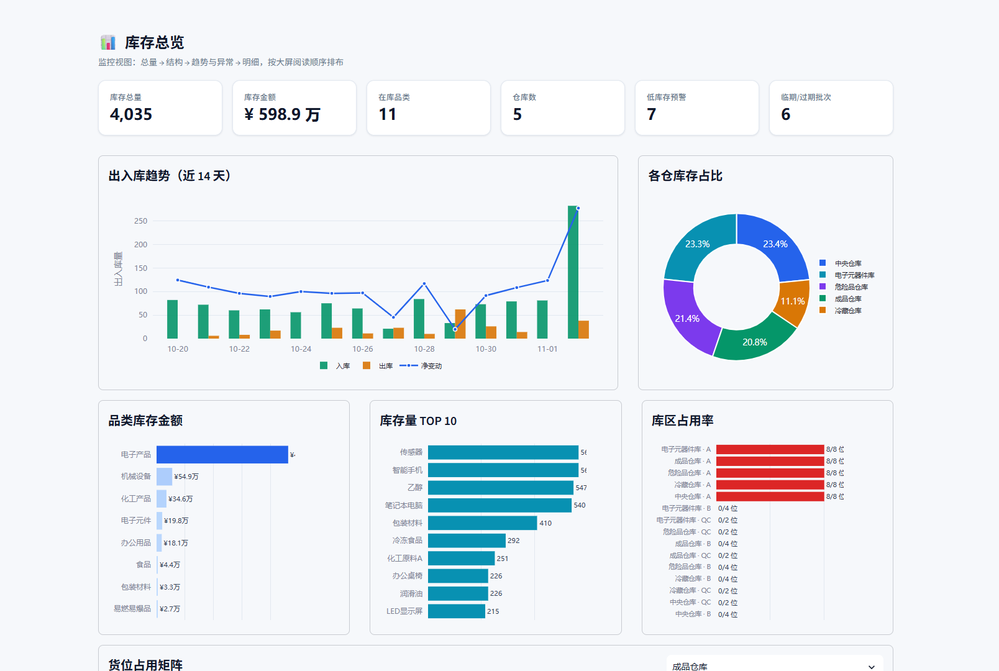
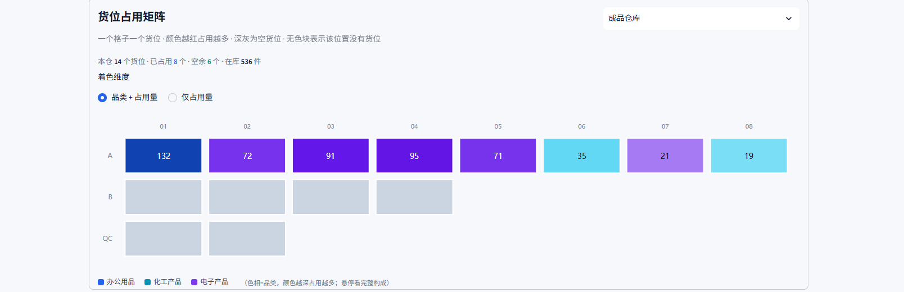

# 智能仓库管理系统 V2 · 重构版

> SQL Server 2025 + Python / Streamlit ｜ 22 表 · 13 视图 · 7 存储过程 · 3 触发器
>
> 主要交付版本：在原始单文件程序基础上完成数据库重构与 WMS 作业层扩展。

---

## 一、这一版解决什么问题

V1 能完成"记账"，但回答不了真实仓储最常被问的几个问题：

- 这批货是哪张采购单收的？客户订的 100 件还差多少没发？
- 货放在哪个货位？哪一批先到期？
- 调拨发出去了，目标仓收到了吗？
- 盘点账实不符时，差异怎么入账、怎么追溯？
- 两个人同时出库，会不会把库存扣成负数？

V2 的答案是：**把库存变动全部挂到单据上，把业务不变式下沉到数据库，把事务边界封装进存储过程。**

---

## 二、功能地图

| 页面 | 能力 |
|---|---|
| **库存概览** | 监控大屏：6 项 KPI、出入库趋势、仓库占比、品类金额、库存 TOP10、库区货位占用、周转天数、补货与效期提醒、单仓货位矩阵 |
| **入库管理** | 创建入库单 → 分批收货 → 上架到货位 → 单据进度查询 |
| **出库管理** | 创建出库单 → 按 FEFO 发货 → 单据进度查询 |
| **调拨管理** | 创建调拨单（源仓 / 目标仓 / 双方经办人）→ 发货生成配对流水 → 单据查询 |
| **盘点管理** | 生成盘点单（自动带账面数）→ 录入实盘 → 结案生成盘盈 / 盘亏 |
| **流水记录** | 按类型、物品、经办人筛选，导出明细 |
| **基础数据** | 工厂 / 供应商 / 仓库 / 库位 / 物品 / 员工授权 |
| **系统审计** | 库存变动前后值、权限变更记录 |

所有库存变动都有来源：`Record.SourceType` 取值为 `入库单 / 出库单 / 调拨单 / 盘点单 / 手工`，可回溯到具体单据与行。

---

## 界面预览





---

## 三、架构

```
app.py                       入口：页面装配 + 侧边栏导航
warehouse/
├── config.py                连接参数、连接池、业务阈值
├── db/
│   ├── engine.py            连接池 / 参数化查询 / 存储过程白名单
│   └── errors.py            驱动异常 → 领域异常的唯一映射点
├── repository/              只把 SQL 变成数据对象，不做业务判断
│   ├── master.py            主数据 CRUD
│   ├── stock.py             库存、库位、效期、周转、大屏维度查询
│   ├── operation.py         手工出入库与无单据调拨
│   ├── orders.py            入库 / 出库 / 调拨 / 盘点单据
│   └── audit.py             流水、库存审计、权限审计
├── service/                 用例编排，统一返回 OperationResult
│   ├── inventory.py         出入库与调拨的业务校验
│   ├── orders.py            单据创建、收货、发货、盘点结案
│   └── master_data.py       主数据维护与友好错误
└── ui/                      Streamlit 页面，只调用 service
    ├── theme.py             设计 token（颜色 / 圆角 / 阴影）
    ├── common.py            指标卡、表格、图表、空状态、结果提示
    ├── overview.py          库存总览（大屏）
    ├── inbound.py           入库管理
    ├── outbound.py          出库管理
    ├── stocktake.py         盘点管理
    ├── operations.py        调拨管理
    ├── records.py           流水记录
    ├── master_data.py       基础数据
    └── audit.py             系统审计
```

依赖方向严格单向：`ui → service → repository → db`。

- UI 不认识 SQL，repository 不认识 Streamlit
- service 可脱离界面测试，将来套 FastAPI 可原样复用
- 所有数据库异常在 `db/errors.py` 统一翻译，UI 不解析驱动错误码

---

## 四、数据库设计

### 4.1 对象规模

| 对象 | 数量 | 说明 |
|---|---|---|
| 表 | 22 | 主数据 7、库位与授权 4、库存与流水 3、单据 8 |
| 视图 | 13 | 统一库存、库位、效期、单据进度与审计口径 |
| 存储过程 | 7 | 覆盖手工出入库、调拨、收货、发货、盘点、使用量重算 |
| 触发器 | 3 | 库存同步、仓库使用量同步、权限审计 |
| 索引 | 13 | 按真实查询路径建立，含 1 个筛选索引 |

完整字段说明见 [`../docs/07-数据字典.md`](../docs/07-数据字典.md)，ER 图见 [`docs/ER图.drawio`](docs/ER图.drawio)。

### 4.2 表分组

**主数据**：`Factory`、`Supplier`、`WarehouseType`、`Warehouse`、`Item`、`Staff`、`Customer`

**库位与授权**：`WarehouseZone`（库区）、`StorageLocation`（货位）、`StaffAssignment`（员工 × 仓库授权）

**库存与流水**：`Storage`（库存单元）、`Record`（出入库流水）、`StockAudit`、`PermissionAudit`

**作业单据**：`InboundOrder / InboundOrderLine`、`OutboundOrder / OutboundOrderLine`、`StocktakeOrder / StocktakeLine`、`TransferOrder / TransferOrderLine`

### 4.3 关键建模决策

**库存单元的五元组唯一键**

```sql
UNIQUE (ItemID, WarehouseID, SupplierID, BatchNo, LocationID)
```

同一供应商的两批货必须分开记账，否则 FEFO 无从谈起；同一批次放在两个货位也应视为两个库存单元，拣货才能定位。

**审计表拆分**

V1 用一张 `AuditLog` 同时记录库存与权限，`OldQuantity` 存过 `StaffID`、`NewQuantity` 存过 `WarehouseID`。V2 拆成：

- `StockAudit`：批次级变动前后值、来源流水
- `PermissionAudit`：授权 / 解除授权的动作与操作人

**计算列统一口径**

`StocktakeLine.Variance = CountedQty - BookQty`，未录入实盘数时为 `NULL`（未盘），避免被误读成"整仓盘亏"。

**仓库类型字典化**

原版把类型存成自由文本、前端硬编码三个选项，而库里实际有五类。V2 抽成 `WarehouseType` 字典表，新增类型不需要改代码。

### 4.4 存储过程

| 过程 | 一次调用完成 |
|---|---|
| `sp_PostOperation` | 手工出入库：权限 → 库存 / 库容 → 写流水（触发器同步库存） |
| `sp_TransferStock` | 无单据调拨：双人权限 → 锁库存 → 两条同组流水 |
| `sp_ReceiveInbound` | 按入库单行收货：剩余待收 → 权限 → 货位归属 → 库容 → 写流水 → 回写行数量 → 推进单头状态 |
| `sp_ShipOutbound` | 按出库单行发货：待发 → 权限 → 库存 → 写流水（触发器按 FEFO 选批） |
| `sp_ShipTransfer` | 调拨发货：双向权限 → 源库存 / 目标库容 → 两条同组流水 → 推进状态 |
| `sp_CompleteStocktake` | 盘点结案：逐行比对差异 → 生成盘盈 / 盘亏流水 |
| `sp_RecalcWarehouseUsage` | 按库存重算仓库使用量，用于巡检与修复 |

**为什么事务边界放在数据库**：进程可能在中途被终止，应用层事务依赖代码执行到底；放进存储过程后由引擎守护，也保证任何客户端走同一套规则。

### 4.5 并发控制

库存校验与扣减分处两条语句时，中间存在超卖窗口。V2 在读取待发数量、源库存、目标库容时统一使用：

```sql
WITH (UPDLOCK, HOLDLOCK)
```

把"读取—判断—写入"圈进同一临界区，直到事务提交才释放锁。

### 4.6 FEFO：先到期先出

```sql
ORDER BY CASE WHEN ExpiryDate IS NULL THEN 1 ELSE 0 END,  -- 有效期的优先出
         ExpiryDate ASC,                                   -- 越临期越先出
         StorageID ASC                                     -- 同效期按批次先后
```

只按入库先后出库，会让临期货积压在库。食品、医药、化工的效期是硬约束，这一项直接对应损耗。

### 4.7 触发器

| 触发器 | 守住的不变式 |
|---|---|
| `TR_Record_StockSync` | 有流水必有库存变动；出库按 FEFO 扣减并写 `StockAudit`；用游标遍历 `inserted`，支持多行 |
| `TR_Storage_SyncUsage` | `Warehouse.WarehouseUsage` 恒等于该仓库库存之和 |
| `TR_Assignment_Audit` | 权限的任何增删都写入 `PermissionAudit` |

触发器只做数据一致性；需要给用户明确原因的校验留在存储过程，因为触发器里抛错难以组织友好提示。

### 4.8 索引

索引跟着查询走，每条都能对应真实访问路径。两处值得说明：

- `IX_Assignment_Warehouse (WarehouseID, StaffID)`：主键是 `(StaffID, WarehouseID)`，"按仓库查员工"是反向前缀，用不上主键索引
- `IX_Record_Transfer ... WHERE TransferGroupID IS NOT NULL`：筛选索引，只索引调拨流水，体积远小于全表索引

---

## 五、界面与交互

### 5.1 设计系统

颜色、圆角、阴影集中在 `warehouse/ui/theme.py`，页面只引用语义名（`BRAND` / `DANGER` / `MUTED`），不写十六进制。

`.streamlit/config.toml` 把主题锁定为浅色。这不是可选项：设计 token 基于"浅底深字"，若系统处于深色模式，Streamlit 会把未被覆盖的文字翻成浅色，与自定义浅色背景撞成"浅底浅字"。

### 5.2 交互约定

| 场景 | 处理 |
|---|---|
| 建单 | 物品下拉显示"名称 [规格] - 厂家"，逐行添加明细，避免空表下拉渲染成内码 |
| 数量输入 | 出库 / 调拨提供 25% / 50% / 全部快捷值 |
| 提交前预判 | 入库显示剩余库容，出库显示可用量，调拨同时给出源库存与目标库容 |
| 操作反馈 | 成功走右下角 toast，不用成功提示把页面内容往下挤 |
| 删除 | 必须先勾选确认，未选中记录时按钮置灰 |
| 空状态 | 给出"下一步该做什么"，而不是"暂无数据" |
| 错误 | 业务拒绝与程序故障分开，异常栈折叠进"技术细节" |

### 5.3 监控大屏

信息层次自上而下：

| 层 | 内容 | 回答的问题 |
|---|---|---|
| 1 | 库存总量 / 金额 / 品类 / 仓库数 / 低库存 / 临期 | 今天整体什么状态 |
| 2 | 出入库趋势（柱 + 净变动折线）、仓库占比（环形） | 货进得快还是出得快、压在哪个仓 |
| 3 | 品类金额、库存量 TOP10、库区货位占用 | 钱压在哪类货、哪些货占地方、仓容是否吃紧 |
| 3.5 | 单仓货位矩阵（色相=品类、明度=占用量） | 哪个货位放了什么、放了多少、还空几格 |
| 4 | 周转天数、补货与效期待办、近期流水、仓库容量 | 有没有呆滞、缺货、临期 |

大屏上的几个取舍：

- 图表高度 ≥ 280、字号 ≥ 12，保证远距离可读
- 库区占用按"已用货位 / 总货位"，不按"件数 / 库容"——后者对 2000 容量的货位永远接近 0
- 趋势图右轴不标刻度，左轴已给量级，两套刻度互相干扰
- 货位矩阵用矩形逐格绘制：Heatmap 的 colorscale 是一维的，表达不了"色相=品类、明度=占用量"
- 矩阵中"深灰=空货位、无色=没有该货位"，避免把不存在的货位误读成空位
- 明细表默认收起，首屏留给图

---

## 六、运行

### 6.1 一键启动

双击 `启动.bat`。脚本会读取本地 `db.env`，检测数据库，首次运行时询问是否建库并导入演示数据，随后创建虚拟环境、安装依赖并启动。

默认地址：<http://localhost:8502>

### 6.2 手动启动

```bash
python -m venv .venv
.venv\Scripts\python.exe -m pip install -r requirements.txt
.venv\Scripts\python.exe -m streamlit run app.py --server.port 8502
```

建库与配置说明见 [`../docs/05-运行与部署.md`](../docs/05-运行与部署.md)。

> `sql/01_schema.sql` 含 `DROP DATABASE WarehouseDB_V2`，只用于本地重建，请勿对已有正式库执行。

### 6.3 配置项

| 环境变量 | 默认值 | 说明 |
|---|---|---|
| `WAREHOUSE_DB_SERVER` | `localhost` | SQL Server 实例 |
| `WAREHOUSE_DB_NAME` | `WarehouseDB_V2` | 数据库名 |
| `WAREHOUSE_DB_USER` | 空 | 留空则用 Windows 集成认证 |
| `WAREHOUSE_DB_PASSWORD` | 空 | SQL 身份验证时使用 |
| `WAREHOUSE_DB_DRIVER` | `ODBC Driver 17 for SQL Server` | ODBC 驱动 |
| `WAREHOUSE_SAFETY_STOCK` | `20` | 安全库存阈值 |

---

## 七、测试

```bash
.venv\Scripts\python.exe tests\db_smoke.py      # 12 项：约束 / 触发器 / 过程
.venv\Scripts\python.exe tests\wms_smoke.py     # 14 项：单据作业链路
.venv\Scripts\python.exe tests\test_service.py  # 14 项：应用层校验
```

覆盖点包括：FEFO 扣减顺序、审计前后值、权限拒绝、库存不足、库容不足、超量调拨回滚无残留、分批收货状态推进、盘点差异生成、重复结案拒绝。

测试说明见 [`../docs/06-测试与验证.md`](../docs/06-测试与验证.md)。

---

## 八、已知边界

这一版有意保留的扩展口，不是未完成项：

- **并发压测**：锁粒度可换 `UPDLOCK, ROWLOCK`，对比不同并发下的超卖率与吞吐
- **执行计划对比**：13 条索引都能配一组"建索引前后"的 `SET STATISTICS IO` 数据
- **权限细化**：当前粒度是"员工 × 仓库"，可下沉到"员工 × 仓库 × 物品类别"
- **前后端分离**：service 层是纯 Python 用例，套 FastAPI 即可提供 REST 接口
- **每日库存快照**：当前趋势看的是流水，若要还原历史水位需增加快照表，不做近似反推

---

## 九、文档

| 文档 | 内容 |
|---|---|
| [项目概述](../docs/01-项目概述.md) | 背景、目标、成果 |
| [数据库设计](../docs/02-数据库设计.md) | 表、范式、约束、视图、过程、触发器、索引 |
| [系统架构与实现](../docs/03-系统架构与实现.md) | 分层、调用链、事务、界面 |
| [版本差异](../docs/04-版本差异与迁移说明.md) | V1 → V2 逐项改造 |
| [运行与部署](../docs/05-运行与部署.md) | 环境、配置、排错 |
| [测试与验证](../docs/06-测试与验证.md) | 测试清单与覆盖 |
| [数据字典](../docs/07-数据字典.md) | 22 张表字段说明 |

---

**作者 / 维护者：Zero**
